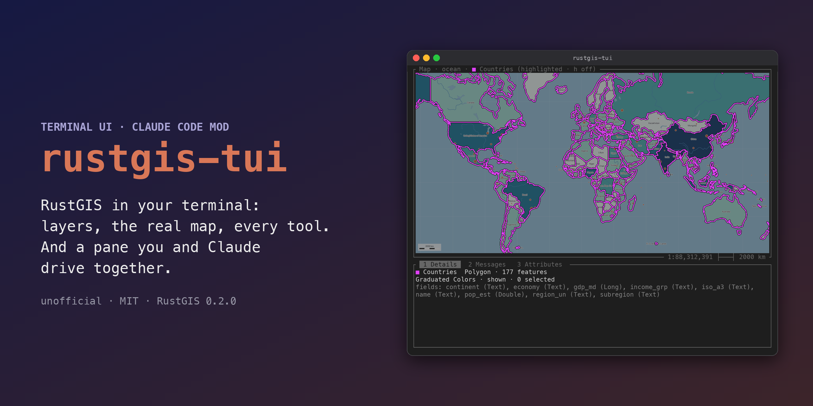
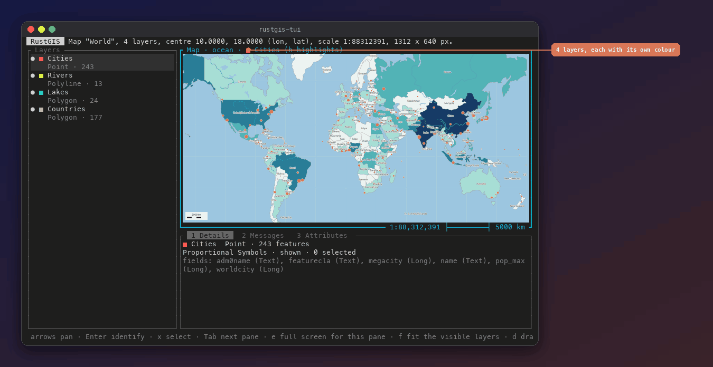
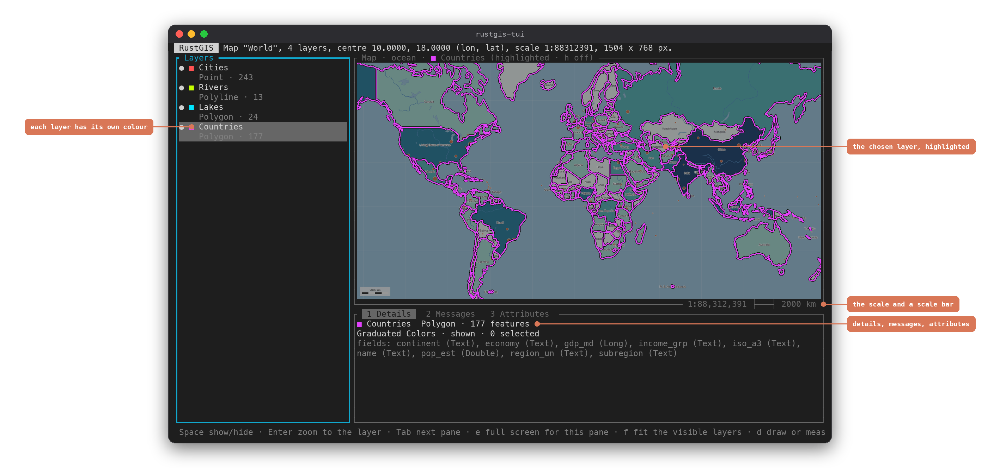
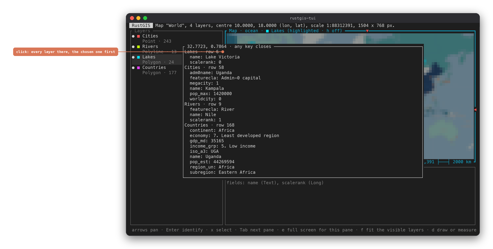
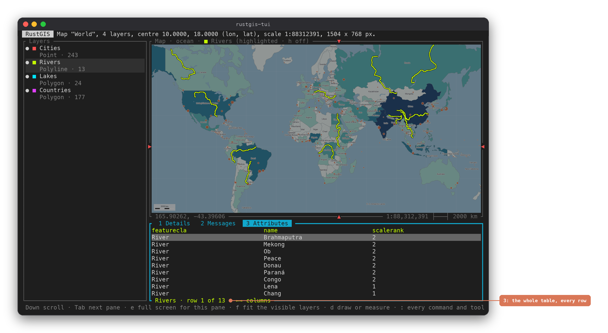
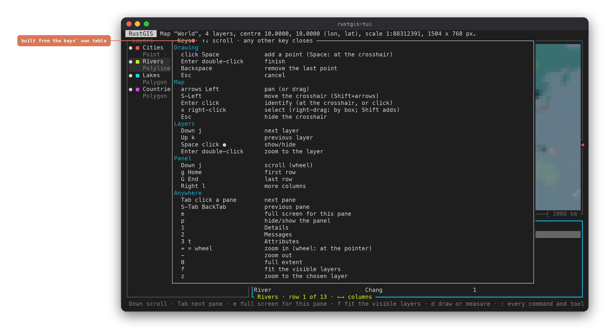
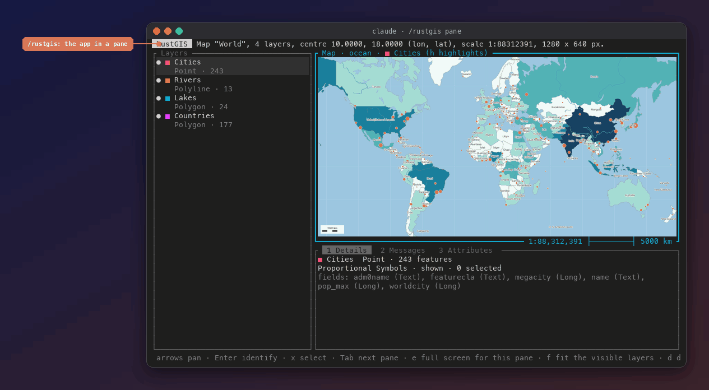

<h1 align="center">rustgis-tui</h1>

  
  
  
  
  

A terminal UI for [RustGIS](https://github.com/opengeos/RustGIS): layers, a real map picture, every RustGIS command and
geoprocessing tool, attribute tables, identify, select, draw and measure, from the keyboard and the mouse. It also comes
as a **Claude Code mod**: a pane in Claude Code that shows the same app, which you drive with keys and clicks while
Claude drives the same running app with its own tools.

> [!NOTE]
> **Unofficial.** Not affiliated with opengeos, the RustGIS project or Anthropic. It drives the `rustgis-cli` program
> through its MCP server (`rustgis-cli mcp`), the same commands an AI agent would use, and contains no RustGIS code.
> RustGIS is at 0.x and changes daily; this was built against **RustGIS 0.2.0**.

## 📥 Install

1. **RustGIS's command line**, `rustgis-cli` 0.2.0, on your `PATH`. The
   [RustGIS releases](https://github.com/opengeos/RustGIS/releases) have it as its own download for macOS
   (`rustgis-cli-0.2.0-macos-aarch64.tar.gz`, `-x86_64`). Whether the Linux and Windows packages include it has not been
   checked. Or set `RUSTGIS_CLI=/path/to/rustgis-cli`.
2. **rustgis-tui itself** (Rust 1.85 or later):

       cargo install --locked --git https://github.com/helenkwok/rustgis-tui

3. **The Claude Code mod** (optional; Claude Code 2.1.300 or later), from the `helenkwok-mods` marketplace:

       claude plugin marketplace add helenkwok/gsd-status-mod
       claude plugin install rustgis-tui@helenkwok-mods

   Then `/rustgis` in a session opens the pane. To try it without installing, see
   [Try it from a clone](#-try-it-from-a-clone).

## ✨ Features

Choose a layer and it lights up on the map, click to see what is there, zoom where you point, then the attribute table and the palette.

- **The map as a real picture** in Ghostty, kitty, WezTerm and iTerm2 (half blocks elsewhere, and always inside tmux),
  drawn by RustGIS at the pane's exact size. The pointer's longitude and latitude, the scale and a scale bar sit on the
  map's border.
- **Layers** with a colour each: choose one and its shapes are highlighted on the map in that colour, the rest dimmed.
  The chosen layer is also RustGIS's active layer, so commands that take no layer act on it.
- **Every command and tool**: `:` searches all of RustGIS's commands and geoprocessing tools (352 in 0.2.0), with their
  parameters as JSON.
- **A panel** with three tabs: the chosen layer's details, messages, and its whole attribute table (every row: 300,000
  rows open in about half a second).
- **Mouse**: click to identify (every visible layer at the spot, the chosen one first), drag to pan, wheel to zoom
  around the pointer, right-click or right-drag to select.
- **Draw and measure**: points, lines, polygons, rectangles and circles into a Graphics layer; distance and area on the
  sphere.
- **The AI assistant** (`a`), through `rustgis-cli ask` with your own model provider.
- **The Claude Code pane**: the same app in a pane, driven by you and by Claude together. See
  [The Claude Code pane](#-the-claude-code-pane).

A click on Lake Victoria with Lakes chosen: the chosen layer first, then every other visible layer at that spot.

Rivers chosen: highlighted in its own colour, with its attribute table in the panel (<code>3</code>).

## 🕹️ Using it

    rustgis-tui                         # the World Atlas sample
    rustgis-tui --data parcels.geojson  # your data (--data more than once, or --project p.rgis)
    rustgis-tui --safe                  # no file or network access (see What it can touch)

Three panes: **Layers** on the left, the **Map**, and the **panel** under it. The active pane has a thick cyan border;
Tab and Shift+Tab move between them, a click makes a pane active, and `e` gives it the whole screen. Keys depend on the
active pane. `?` lists them all: the list is built from the same table the keys run from, and so is the footer.

| Key | Where | What it does |
| --- | --- | --- |
| arrows, `j` `k` | Layers | Choose a layer |
| Space, click `●` | Layers | Show or hide it |
| Enter, double-click | Layers | Zoom to it |
| arrows, drag | Map | Pan |
| wheel, `+` `-`, `0` | anywhere | Zoom (the wheel at the pointer), full extent |
| click, Enter | Map | Identify (Enter: at the crosshair) |
| right-click, `x` | Map | Select (right-drag: by box; Shift adds) |
| Shift+arrows, Esc | Map | Move the crosshair, hide it |
| `f`, `z` | anywhere | Fit every visible layer, zoom to the chosen one |
| `h` | anywhere | Highlight the chosen layer on the map, on or off |
| `d` then `p` `l` `o` `r` `c` | anywhere | Draw a point, line, polygon, rectangle or circle |
| `d` then `m` / `M` | anywhere | Measure distance / area |
| `1` `2` `3`, `t` | anywhere | Details, Messages, Attributes (`t`: the attribute table) |
| arrows, PgUp/PgDn, `g` `G`, ←→ | panel | Scroll, first and last row, more columns |
| `:` or `/` | anywhere | Search every command and tool |
| `g`, `b` | Map | Globe or flat, next basemap |
| `u` `U`, `s`, `a`, `r`, `q` | anywhere | Undo, redo, save as, ask the assistant, redraw, quit |

While drawing: click or Space adds a point, double-click or Enter finishes, Backspace removes the last point, Esc
cancels. The map title shows the length or area so far.

## 🧩 The Claude Code pane

The mod runs `rustgis-tui --serve` (no terminal of its own) and shows its screen in a Claude Code pane, with the real map
picture laid over the map area.

- `/rustgis` opens the pane and starts RustGIS; `/rustgis close`, or closing the pane, stops it.
- **You**: click the pane, then type and click as in the terminal. In the pane `` ` `` (backtick) stands in for Escape,
  which Claude Code keeps for itself.
- **Claude**: two tools, `screen` (the whole screen as text, and the path of the map picture) and `send` (keys, typed
  text, clicks, drags and the wheel, then the new screen). They go into the same running app, through the same input
  queue as yours, so what Claude does you see, and the other way round.
- Idle, it costs about 0.1% CPU for the app and about 2% for the pane's frame checks; it checks often for two seconds
  after any input or new frame and four times a second otherwise.

The pane needs a terminal with kitty graphics and unicode placeholders for the picture: Ghostty or kitty.

You click and type; Claude sends keys with its <code>send</code> tool; both go to the same running app.

## 🧠 How it works

- **One RustGIS, through MCP.** rustgis-tui starts `rustgis-cli mcp` and talks to it over stdio: the same command
  registry the desktop app's ribbon and the AI assistant use. The map is RustGIS's own `view_map` picture at the pane's
  size; a click is turned into longitude and latitude from the view's extent (Web Mercator).
- **Highlights** are drawn by rustgis-tui into the picture, not by RustGIS: the layer's shapes are exported once as
  GeoJSON to a temporary file, read and deleted. Nothing in your project changes.
- **Attribute tables** come from RustGIS's Export Features to a temporary CSV (deleted after reading), because the MCP
  replies are cut at about 8,000 characters. With `--safe` it falls back to reading at most 200 rows.
- **Serve mode** (`--serve DIR`, for the pane): each frame is written to `DIR/frame.json` (the screen as cells, the same
  as text, and where the map sits) with the map as `DIR/map-N.png`, and input is read from `DIR/in/`. While a popup is
  open the map is drawn in the cells instead, so the popup shows on top.

## 🔒 What it can touch (reach)

- **rustgis-tui** starts `rustgis-cli mcp --yes`, which lets RustGIS read and write files and use the network when a
  command asks for it (web basemaps, Export, Save As, Add Data from a URL). `--safe` leaves `--yes` out: RustGIS then
  refuses those commands, and the full attribute table, highlights and the assistant are off.
- It writes temporary files in the system temp folder (`rustgis-tui-<pid>-…`) and deletes them after reading.
- **The assistant** (`a`) runs `rustgis-cli ask` with whatever model provider your environment configures
  (`RUSTGIS_ASSISTANT_PROVIDER`, `RUSTGIS_ASSISTANT_MODEL`, or an API key). It may change the project; `u` undoes.
- **The mod** runs `rustgis-tui --serve` as a child process, reads and writes its frames and input under
  `/tmp/rustgis-tui-pane-<random>` (removed when it stops), and makes no network calls of its own.
  `claude plugin validate claude-mod` lists every hook and `$` call it makes.

## 🧪 Try it from a clone

    git clone https://github.com/helenkwok/rustgis-tui ~/rustgis-tui
    cd ~/rustgis-tui
    cargo run --release                          # the terminal UI
    claude --plugin-dir ~/rustgis-tui/claude-mod  # the mod, for one session (needs rustgis-tui on PATH)

Checks:

    cargo test                                    # key map, CSV, geometry, serve-mode input
    claude plugin validate claude-mod
    claude plugin test claude-mod
    python3 docs/tools/screenshots.py             # redraw the README screenshots (needs Pillow)

The images are drawn from serve-mode frames, the same ones the pane shows, not captured from a terminal; the window
frame and the orange notes are added.

## ❓ FAQ

**The map is blocky.** The terminal has no image support, or it runs inside tmux (where rustgis-tui uses half blocks on
purpose: the image query would eat the first key press). Ghostty, kitty, WezTerm and iTerm2 show the real picture.

**A click on the map says to switch to the flat map.** Clicks map to coordinates on the flat (Web Mercator) map only;
`g` switches from the globe.

**A plain drag no longer selects text in the terminal.** The app takes the mouse. Hold Shift (Ghostty) to select text.

**Where does the pane go?** `/rustgis` opens it docked beside the conversation in a fullscreen terminal 110 columns or
wider, and above the prompt otherwise. Close it with `/rustgis close` or Claude Code's own close mark.

## 🚧 Not handled yet

- A drag pans when you let go, not while you drag: each move redraws the whole picture.
- Clicks on the globe.
- The crosshair shows as ticks on the map's border in image terminals (a character over the picture breaks it there).
- The mod has not been tried on Linux or Windows.
- Binary releases: for now `cargo install` builds it.

## 📝 Changelog and license

Release notes: [CHANGELOG.md](CHANGELOG.md). MIT, see [LICENSE](LICENSE). Not affiliated with opengeos, RustGIS or
Anthropic. RustGIS is © its authors under the Apache License 2.0.
